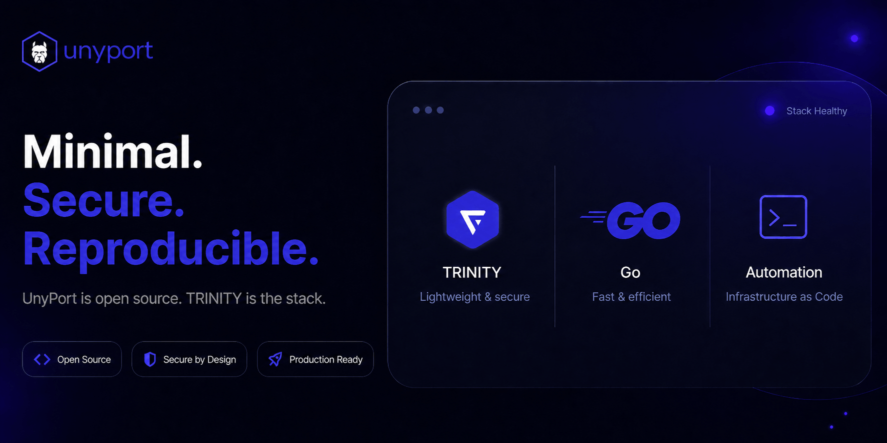
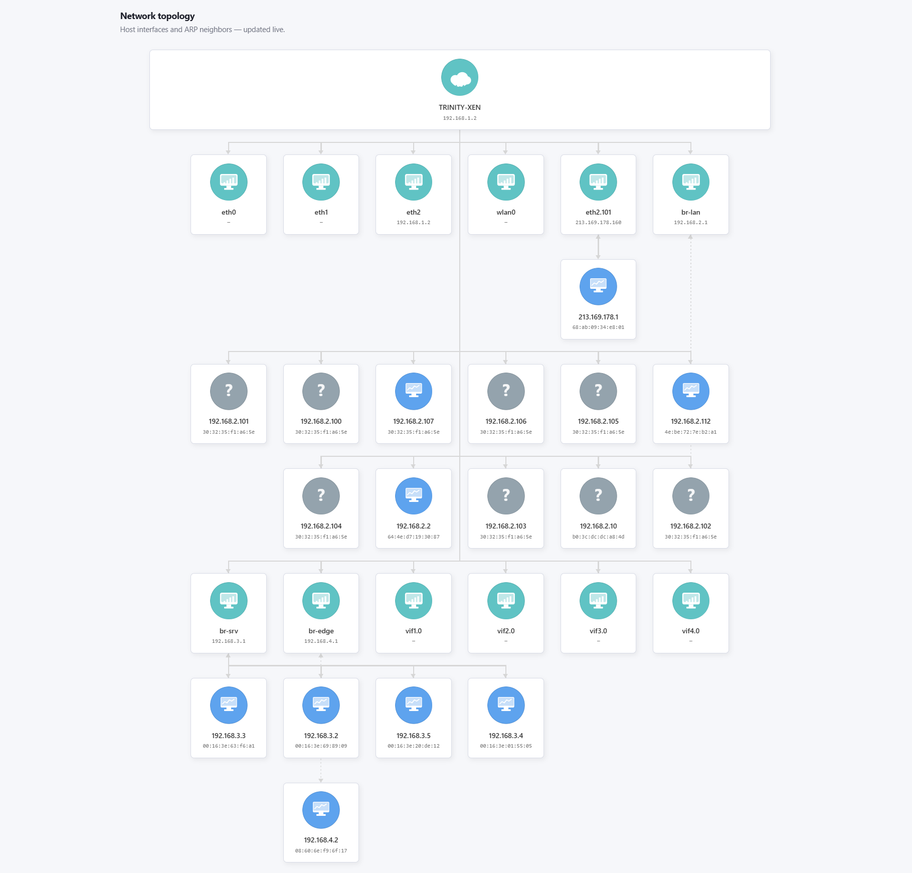

# UnyPort v0.60.16

- Enrichit automatiquement les voisins réseau depuis les leases, réservations Kea et `/etc/hosts`.
- Détecte les télévisions, téléphones, postes de travail et équipements WAN avec des icônes adaptées.
- Affiche les hostnames normalisés en majuscules sur les cards tout en conservant les détails dans les tooltips.
- Intègre les assets dual-tone v3 pour Smart TV et NAS.
- Fiabilise le redémarrage OpenRC avec arrêt forcé lorsque nécessaire.
